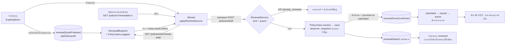

# งาน 3 — การต่ออายุกรมธรรม์ (ค้นหาและดึงข้อมูลเดิม)

ที่มา: ClickUp `z8qu5d0quy` (ซับทาสก์ 3.1–3.5) · ทำเมื่อ 2026-10-03 · เทียบกับโค้ดต้นฉบับ `insurehub-main.zip`

## 1. สรุป

| ซับทาสก์ | ผลลัพธ์ |
|---|---|
| 3.1 รายการช่องที่ต้องกรอกใหม่ (config เดียว) | `RenewalBlueprint` ฝั่ง backend เป็นที่เดียวที่กำหนดว่าช่องไหน ลอก / ล้าง / คำนวณใหม่ / ต้องยืนยัน + `GET /policies/{id}/renewal-draft` |
| 3.2 ปีลูกค้า / ปีกรมธรรม์ คำนวณฝั่ง server | `PolicyYears::resolve()` คำนวณทุกครั้งที่บันทึก ไม่เชื่อค่าจาก client — แก้เองได้เฉพาะแอดมิน และบันทึก audit |
| 3.3 ปุ่ม "ค้นหากรมธรรม์เดิม" | ปุ่ม + modal ค้นด้วยเลขกรมธรรม์ / เลขใบคำขอ / ทะเบียนรถ / ชื่อ-นามสกุลหรือเลขบัตรลูกค้า / รหัสตัวแทน แสดงเฉพาะฉบับที่ยังต่ออายุได้ |
| 3.4 ป้ายปี/งวด `1# $2 3/12` | `PolicyPeriodLabel` (formatter กลาง backend) + `<PolicyPeriodBadge>` ในรายการกรมธรรม์, หน้ากรมธรรม์, คิวต่ออายุ, รายละเอียดต่ออายุ, งวดชำระ, ติดตามเงิน, PDF คิวต่ออายุ |
| 3.5 กันต่ออายุซ้ำ + ลิงก์ chain | `RenewalService` lock แถวต้นทาง แล้วตอบ 422 (`already_renewed`) พร้อมลิงก์ไปฉบับที่มีอยู่ หน้ากรมธรรม์แสดงลิงก์ "ต่ออายุจาก / ต่ออายุเป็น" |

**การตัดสินใจทางธุรกิจ (ยืนยันกับผู้ใช้แล้ว):**
- เปลี่ยนบริษัทประกัน = เปลี่ยนผลิตภัณฑ์
- เบี้ย/ทุน/ส่วนลด ลอกมา (ถ้ามีใบเสนอราคาต่ออายุ ใช้ตัวเลขจากใบนั้นก่อน) แล้วต้องติ๊กยืนยันก่อนส่งบริษัท
- แก้ปีเองได้เฉพาะแอดมิน
- รูปแบบป้าย `{ปี}# ${สลักหลัง} {งวด}/{จำนวนงวด}`

## 2. ปัญหาที่พบก่อนแก้ (ถ่ายภาพจากระบบจริง)

| # | ปัญหา | สาเหตุ |
|---|---|---|
| B1 | หน้าสร้างกรมธรรม์ไม่มีที่ค้นกรมธรรม์เดิม กด "ต่ออายุ" ก็ไม่มีอะไรขึ้น | เริ่มต่ออายุได้ทางเดียวคือ `?renewFrom=<id>` |
| B2 | เบี้ย ทุน ส่วนลด และอัตราคอมฯ ถูกลอกจากปีก่อนทั้งหมด ไม่มีไฮไลต์ ไม่มีขั้นยืนยัน | กฎลอก/ล้างฮาร์ดโค้ดใน `hydrateFromDraft()` ฝั่ง frontend |
| B3 | ต่ออายุ S4 ได้ 2 ใบ (ร่าง 2 ใบชี้ไปต้นทางเดียวกัน) | `storeDraft` กันแค่ event `renewalStarted` ซ้ำ ไม่ได้กันการสร้างกรมธรรม์ซ้ำ |
| B4 | หน้ากรมธรรม์ไม่มีลิงก์ปีก่อน/ปีถัดไป ไม่มีป้ายปี/งวด และกด "ต่ออายุ" ซ้ำได้ | `PolicyResource` ไม่ส่ง `refAppToId` / chain ออกมา |
| B4b | **ข้อมูลเสีย:** เปิดร่างต่ออายุแล้วพิมพ์อะไรก็ได้ autosave จะตั้ง `ref_app_to_id` เป็น NULL (ดู `before-B4b-autosave-unlinks-renewal.txt`) | resource ไม่ส่ง `refAppToId` → wizard ได้ `''` → ส่ง `null` กลับไป |
| B5 | คิวต่ออายุขึ้น "ต่ออายุแล้ว" ทั้งที่ฉบับต่ออายุถูกยกเลิกไปแล้ว (S5) | `renewalStage` ดูแค่ว่าเคยมี event `renewalStarted` หรือไม่ |
| B6 | หน้ารายการไม่มีปี/งวด | — |
| เพิ่ม | ค่าคอมฯ ปีต่ออายุของ life ใช้อัตราปีที่ 1 | observer จับ snapshot ค่าคอมฯ ก่อน `seedYears` และ wizard ใช้ `yr1` เสมอ แถมลอกอัตราจากปีก่อนแล้วล็อกไว้ |
| เพิ่ม | ตัวเลขในใบเสนอราคาต่ออายุไม่ไหลเข้าร่างต่ออายุ | ตัวเลขอยู่ใน PDF อย่างเดียว ไม่ได้บันทึกเป็นข้อมูล |
| เพิ่ม | บันทึกร่างไม่ผ่านแล้วผู้ใช้ไม่รู้ | `doAutosave` จับ error แล้วเงียบ |

## 3. กฎปีของกรมธรรม์ / ปีของลูกค้า (`PolicyYears::suggest` + `resolve`)

| กรณี | ปีลูกค้า | ปีกรมธรรม์ |
|---|---|---|
| ต่ออายุ ผลิตภัณฑ์เดิม | เดิม +1 | เดิม +1 |
| ต่ออายุ แต่เปลี่ยนผลิตภัณฑ์ (รวมถึงเปลี่ยนบริษัท) | เดิม +1 | 1 |
| ลูกค้าใหม่ | 1 | 1 |
| กรมธรรม์ใหม่ของลูกค้าเก่า | ลำดับปีนับจากกรมธรรม์แรกของลูกค้า | 1 |

ลำดับการทำงานใน `resolve()`:
1. แอดมินส่ง `yearsOverride: true` → ใช้ค่าที่แอดมินกรอก ตั้ง `years_overridden = true` แล้วเขียน `AuditEntry policy.years_overridden` เก็บทั้งค่าที่ระบบแนะนำและค่าที่เลือก
2. เคยมีแอดมิน override และฐานการคำนวณไม่เปลี่ยน (ผลิตภัณฑ์ / ต้นทาง / ลูกค้า) → คงค่าเดิมไว้
3. กรมธรรม์ใหม่ / สถานะ draft-quotation / ฐานการคำนวณเปลี่ยน → คำนวณใหม่ และล้าง override
4. กรมธรรม์ที่มีผลแล้วและไม่มีอะไรเปลี่ยน → ไม่แตะปีที่บันทึกไว้

คนที่ไม่ใช่แอดมินส่งปีมา ระบบจะไม่สนใจ (`PolicyRequest::toModel()` ไม่ map ค่าปีอีกต่อไป และ `patchSection` ตัดค่าปีทิ้ง)

## 4. Blueprint ของช่องข้อมูล (`RenewalBlueprint`)

| กลุ่ม | ช่อง |
|---|---|
| **ลอก (COPY)** | ลูกค้า, ตัวแทน, ผลิตภัณฑ์, บริษัท, risk/รายละเอียดรถ, โหมดชำระ + จำนวนงวด, rider, ผู้รับประโยชน์, หมายเหตุ, เวกเตอร์ค่าคอมฯ รายปี |
| **ล้าง (CLEAR)** | เลขใบเสนอราคา/ใบคำขอ/งาน/กรมธรรม์/notion, วันที่ของรอบเดิม, การรับ/อนุมัติ/จัดส่ง/tracking, การยกเลิก/คืนเบี้ย, วันครบกำหนดงวดเดิม, snapshot ค่าคอมฯ และอัตราคอมฯ headline |
| **คำนวณใหม่ (RECOMPUTE)** | `status=draft`, `new_or_renew=renew`, `ref_app_to_id`, วันเริ่มคุ้มครอง = วันหมดอายุเดิม (ระยะเท่ารอบเดิม), ปีกรมธรรม์/ปีลูกค้า, อัตราคอมฯ ของปีใหม่ (คิดจากผลิตภัณฑ์ตอนบันทึก) |
| **ต้องยืนยัน (MUST_CONFIRM)** | เบี้ยรวม, เบี้ยสุทธิ, อากร, VAT, รวมเบี้ย, ทุนประกัน, ส่วนลด, วันเริ่ม/สิ้นสุด, ทะเบียนรถ |

ถ้ามีใบเสนอราคาต่ออายุ (event `renewalQuotePrepared` ที่มี `payload.quote` และเอกสารยังอยู่) ร่างจะใช้เบี้ย/ทุน/โหมดจากใบนั้น แล้วล้าง net/อากร/VAT เพื่อให้ผู้ใช้กดสูตรคำนวณใหม่

## 5. การไหลของข้อมูล



## 6. API ที่เพิ่ม/เปลี่ยน

| Endpoint | การเปลี่ยนแปลง |
|---|---|
| `GET /policies/{id}/renewal-draft[?exceptId=]` | **ใหม่** — ส่งร่างตามรูป PolicyResource + `meta` (`mustConfirm`, `quoteUsed`, `quote`, `suggestedYears`, `source`) ไม่บันทึกอะไร ตอบ 422 ถ้าต้นทางต่ออายุไม่ได้ |
| `GET /policies` | เพิ่ม `renewable=1`, ค้นชื่อเต็ม/ชื่อนิติบุคคล/เลขภาษี, คืน `policyYear`, `customerYear`, `refAppToId`, `periodLabel` |
| `POST /policies`, `POST /policies/draft`, `PATCH /policies/{id}`, `PATCH /policies/{id}/draft` | ตรวจการต่ออายุซ้ำ (422 `already_renewed` / `source_not_renewable` / `self_renewal` / `renewal_cycle`), คำนวณปีที่ server, รับ `yearsOverride` (แอดมิน) |
| `PATCH /policies/{id}/section/dates` | ค่าปีจากคนที่ไม่ใช่แอดมินถูกเมิน, แอดมิน = override |
| `POST /policies/{id}/promote-to-submitted` | ฉบับต่ออายุต้องส่ง `renewalTermsConfirmed: true` ไม่งั้น 422 แล้วบันทึก event `renewalTermsConfirmed` |
| `GET /policies/{id}` | เพิ่ม `refAppToId`, `renewedFrom`, `renewedTo{live,count}`, `periodLabel`, `yearsOverridden` และ `payments[].periodLabel/installmentNo` |
| `GET /policies/{id}/installments`, `/payments` | เพิ่ม `periodLabel` |
| `POST /policies/{id}/documents/upload` | รับ `quoteAnnualPremium`, `quoteCoverage`, `quotePremiumMode` สำหรับ `renewal_quote_insurehub` |
| `GET /reports/expiring-soon` (+pdf) | stage `renewed` ดูจากฉบับต่ออายุที่ยังมีผล, เพิ่ม `periodLabel`, `renewedPolicyId`, คอลัมน์ ปี/งวด ใน PDF |
| `GET /collections/{id}` | เพิ่ม `periodLabel` ทั้งระดับกรมธรรม์และรายงวด |

DB: migration `2027_03_15_000100_add_years_overridden_to_policies` (boolean `years_overridden`)

## 7. ฝั่งหน้าจอ

- **Wizard** (`PolicyApplicationWizard.vue`)
  - ปุ่ม/การ์ด "ค้นหากรมธรรม์เดิม"
  - `applyRenewalSource()` ใช้ร่วมกันทั้ง modal และ `?renewFrom` เติมข้อมูลในหน้าเดิมโดยไม่ reload
  - ไฮไลต์สีเหลืองช่องที่ต้องยืนยัน + กล่องติ๊กยืนยัน (ไฮไลต์ยังอยู่เมื่อเปิดร่างกลับมาใหม่)
  - แบนเนอร์ 422 พร้อมปุ่ม "เปิดฉบับต่ออายุ" / "เลือกกรมธรรม์อื่น"
  - ช่องปีแก้ได้เฉพาะแอดมิน และอ่านค่าปีกลับจาก server ทุกครั้งที่บันทึก
  - ค่าคอมฯ ตอนต่ออายุ: ไม่แช่แข็ง/ไม่ล็อกของปีเก่า และใช้อัตราตามปีกรมธรรม์
  - สร้างร่างแล้ว `router.replace` ไป `/policies/:id/edit-draft` (กด F5 แล้วไม่สร้างร่างซ้ำ)
  - autosave แสดง error แทนการเงียบ
  - header แสดงป้ายปี/งวด + ลิงก์ "ต่ออายุจาก/เป็น" ส่วนปุ่ม "ต่ออายุ" เปลี่ยนเป็น "เปิดฉบับต่ออายุ" เมื่อมีฉบับต่ออายุอยู่แล้ว
- **Component ใหม่:** `PolicyPeriodBadge.vue` (มี tooltip อธิบายแต่ละส่วน), `RenewalSourceSearchModal.vue`
- **หน้าอื่น:**
  - `PolicyListV2` / `ExpiringSoon` / `RenewalDetail` / `PolicyPaymentModal` / `CollectionDetail` แสดงป้าย
  - `RenewalDetail` แสดงลิงก์ฉบับต่ออายุ และปุ่มต่ออายุไปเปิดฉบับที่มีอยู่
  - `ExpiringSoon` ไม่แสดงบรรทัด "เริ่มต่ออายุ" ถ้าฉบับต่ออายุถูกยกเลิกไปแล้ว
  - `useRenewalActions` ส่งตัวเลขใบเสนอราคาไปพร้อมไฟล์

## 8. การทดสอบ

```powershell
# ฐานข้อมูลทดสอบ MySQL (phpunit.xml ตั้ง sqlite ไว้ แต่บาง migration ใช้ ALTER … MODIFY ของ MySQL)
mysql -uroot -e "CREATE DATABASE IF NOT EXISTS insurehub_testing"
$env:DB_CONNECTION='mysql'; $env:DB_DATABASE='insurehub_testing'; php artisan test
cd frontend; npm run build
```

ผล (2026-10-03):
- **Backend 42/43 ผ่าน**
  - เทสต์ใหม่ 24 ตัวผ่านทั้งหมด: `RenewalFlowTest` 17 ตัว + `PolicyPeriodLabelTest` 7 ตัว (และ `PolicyYearsTest` / `InstallmentScheduleTest` เดิมยังผ่าน)
  - ตัวที่ fail คือ `CommissionSnapshotTest::test_rate_row_newest_effective_from_wins` ซึ่ง **fail อยู่แล้วก่อนแก้** (ลองกับ `Policy.php` ต้นฉบับก็ fail เหมือนกัน — เทสต์ extends `PHPUnit\Framework\TestCase` จึงไม่ได้ boot Laravel)
- **Frontend:** `vue-tsc -b && vite build` ผ่าน

`RenewalFlowTest` ครอบคลุม:
- renewal-draft ลอก/ล้าง/คำนวณถูก และ GET ไม่สร้างข้อมูล
- ใช้ตัวเลขใบเสนอราคาก่อน และไม่ใช้ถ้าเอกสารถูกลบ
- tenant อื่นได้ 404, สถานะ draft ได้ 422
- ต่อซ้ำ 422 ทั้ง `/draft` และ `/policies`
- ฉบับเดิม cancelled / rejected / ถูกลบ → ต่อใหม่ได้
- ปลุกฉบับที่ยกเลิกแล้วขณะมีฉบับอื่นอยู่ → 422
- บันทึกร่างซ้ำแล้วลิงก์ไม่หาย และมี `renewedFrom/To`
- ไม่ใช่แอดมิน: ค่าปีถูกเมิน
- แอดมิน override แล้วค่าคงอยู่ + มี audit, เปลี่ยนผลิตภัณฑ์แล้ว reset
- เปลี่ยนบริษัท = ปีกรมธรรม์ 1, ลูกค้าใหม่ = 1/1
- snapshot ค่าคอมฯ life ใช้อัตราปีที่ 3
- filter `renewable` และการค้นด้วยชื่อเต็ม/ทะเบียน/รหัสตัวแทน/เลขบัตร
- stage ในคิวต่ออายุย้อนกลับเมื่อยกเลิกฉบับต่ออายุ
- ส่งพิจารณาต้องยืนยันก่อน
- ป้าย `1# 3/12` และ `1# $2 3/12` ในหน้ากรมธรรม์ รายการ และงวด

ข้อมูลทดสอบด้วยมือ: `php artisan db:seed --class=RenewalScenarioSeeder` (ใช้กับ dev เท่านั้น ทุกแถวขึ้นต้นด้วย `TSTRN`)

| ข้อมูล | สถานการณ์ |
|---|---|
| S1 | รายเดือน 12 งวด จ่ายแล้ว 2 งวด |
| S2P → S2 | chain ปี 1 → ปี 2 (S2 หมดอายุ) |
| S3 | มีสลักหลัง 2 ครั้ง |
| S4 | มีร่างต่ออายุอยู่แล้ว |
| S5 | ฉบับต่ออายุถูกยกเลิก |

## 9. ภาพก่อน / หลัง

| ฉาก | ก่อน | หลัง |
|---|---|---|
| หน้าสร้าง ส่วนที่ 1 |  |  |
| ค้นหา → เลือก → เติมข้อมูล | — |   |
| เบี้ยปีต่ออายุ |  |   |
| ต่ออายุซ้ำ |  |  |
| หน้ากรมธรรม์ (chain + ป้าย) |  |  |
| autosave ร่างต่ออายุ | `before-B4b-autosave-unlinks-renewal.txt` (ลิงก์หาย) | `after-A4b-autosave-keeps-link.txt` (`ref_app_to_id` = 477 คงอยู่) |
| คิวต่ออายุ |  |  |
| รายการกรมธรรม์ |  |  |

## 10. ข้อจำกัด / งานต่อ

- **NCB และผู้ขับขี่:** ยังไม่มีคอลัมน์ในระบบ ตอนนี้ยืนยันผ่าน "ส่วนลด" และรายละเอียดรถในส่วน risk ไปก่อน
- **เลขสลักหลัง `$N`:** นับจากจำนวน event `endorsement.*` ถ้าลบสลักหลังแบบเบี้ย เลขจะเลื่อน — ควรมีเลขลำดับถาวรในงาน 4
- **กล่องยืนยันเบี้ย:** บังคับเฉพาะเส้นทาง `promote-to-submitted` ถ้าเปลี่ยนสถานะผ่าน dropdown / `PolicyEventController` จะยังไม่ถูกบังคับ
- **หน้ารายการติดตามเงิน (`GET /collections`):** ยังไม่มีป้าย มีเฉพาะหน้ารายละเอียด
- **ไฟล์ legacy:** `PolicyCreateWizard.vue` และ `PolicyDetailDrawer.vue` ไม่มีที่ใช้งานแล้ว จึงไม่ได้แก้
- **ข้อมูลนำเข้าเก่า (import):** chain ที่มีหลายลูกจากการ import ไม่ถูกบล็อกตอนบันทึกซ้ำ ระบบตรวจเฉพาะตอนสร้างลิงก์ใหม่หรือปลุกฉบับที่ยกเลิก
